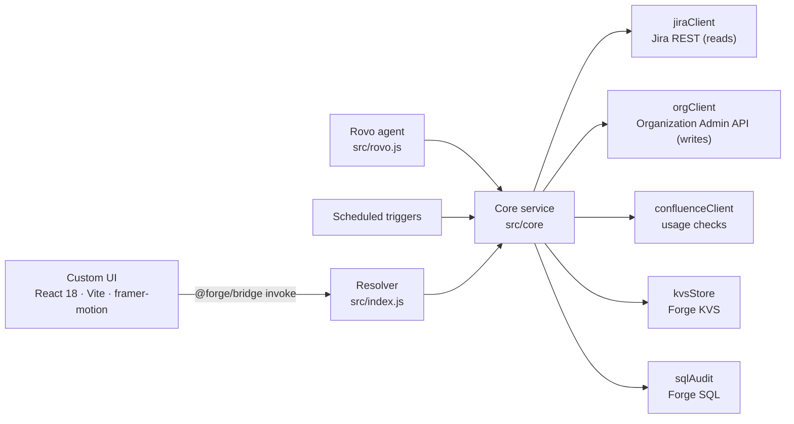

<div align="center">


# Group Self-Service for Jira

**Self-service Atlassian groups for project admins — safe, audited, and reversible.**

A SUPERPORT [Atlassian Forge](https://developer.atlassian.com/platform/forge/) app for Jira Cloud.


</div>

---

> 📘 **New here?** Read the [first-time user tutorial](TUTORIAL.md) — step by step for project admins, members, Jira admins and auditors.

## Why

In most Jira sites only site admins can create groups or change who is in them, so project admins
end up filing tickets for every new teammate. **Group Self-Service for Jira** hands that job to the
project admins — inside a fixed naming convention, with guardrails, an append-only audit log, and
one-click undo for every change. Jira admins keep global control.

## Highlights

| | |
| --- | --- |
| 🧩 **Project-owned groups** | Create real Atlassian groups named `atlassian-<KEY>-<name>`, with name checks against current *and* previous project keys. |
| 👥 **Member management** | Search, paging, active/deactivated status, add several people at once, or paste a list of emails/names and review each match before adding. |
| 🗺️ **People matrix** | "Who is in which group" — plan additions and removals across all project groups, select people for bulk actions (add to / remove from group, same groups as…, remove from all), choose which groups are columns, undo each planning step (Ctrl+Z), apply and undo as one batch. |
| 🔍 **Where-used analysis** | 9 checks: permission schemes, workflows, project roles, issue security levels, notification schemes, shared filters, dashboards, Confluence space permissions and page restrictions. |
| ⚠️ **Impact before removal** | The confirmation shows exactly which schemes and workflows a person loses access through. |
| ↩️ **Undo everything** | Every add, remove, end date, review and config change can be undone; failed items get a Retry. |
| ⏳ **Time-limited access** | Set an end date per membership; an hourly job removes expired access and logs it. |
| 📨 **Access requests** | Project members request access (with reason and 7/30/90 days); project admins approve or deny. |
| ✅ **Access reviews** | Periodic reviews (3/6/12 months) with due badges, mandatory confirmation, and audit notes — ISO 27001 friendly. |
| 📜 **Audit log** | Append-only, filterable, CSV export, project or global scope, configurable retention. Read-only page for auditors. |
| 🔒 **Hard guardrails** | Atlassian core and product-access groups are always blocked; IdP/SCIM-synced groups are read-only; the scope guard stops project admins from adding people to groups that also grant access in other projects. |
| 🤖 **Rovo agent** | 16 actions (list, details, where-used, audit, compliance, create, add/remove, end date, description, requests, a person's groups, same groups as, offboarding, copy members, undo last change). Bulk actions preview first and apply only with `confirm: true`; same permission checks; tagged "via Rovo". |
| 🧭 **Built-in guided tour** | First-time users get a step-by-step tour that highlights the real controls, tailored to their page (project admin, member, Jira admin, auditor). Reopen it any time with **Tutorial**. |
| 🌍 **Native feel** | Follows Jira's light/dark theme and the user's locale (English/German); Jira flags for notifications; respects `prefers-reduced-motion`. |

## Where it lives in Jira

| Module | Who | What |
| --- | --- | --- |
| **Project settings → Apps → Group Self-Service for Jira** | Project admins | Groups, members, people matrix, where-used, requests, audit log |
| **Project page → My groups** | Project members | Own groups (read-only) and access requests |
| **Apps → Group audit log** | Auditors & Jira admins | Read-only global audit log with CSV export |
| **Admin → Group Self-Service for Jira** | Jira admins | Configuration, block list, IdP groups, compliance overview, Org API status |
| **Rovo → Group Self-Service for Jira** | Project admins | Conversational group management |

Background jobs: daily audit retention, hourly membership expiry, hourly Confluence restriction
index, optional daily cleanup of deactivated accounts, and SQL migrations on install/upgrade.

## Architecture



The core service is platform-free and gets its Jira, storage and audit back ends **injected** —
the same code runs in Forge, in the test suite, and in the browser click-dummy.

```
manifest.yml        Forge modules, Rovo agent & actions, triggers, scopes
src/index.js        Resolver wiring – builds the trusted context from Forge
src/core/           Business logic: service, naming, blocklist, csv, errors
src/forge/          Adapters: Jira, Organization API, Confluence, KVS, SQL, usage
src/rovo*.js        Rovo agent actions
src/dev/            In-memory adapters + demo seed (tests & click-dummy only)
static/app/         Custom UI (React 18 + Vite)
test/               node:test suite
scripts/            Offline manifest validation
```

## Getting started

**Prerequisites:** Node.js 22+, the [Forge CLI](https://developer.atlassian.com/platform/forge/getting-started/) (for deploying).

```bash
npm install
npm --prefix static/app install
npm test
```

### Try it without Jira

The click-dummy runs the real service against in-memory demo data:

```bash
npm run dev:ui
```

Open http://localhost:3000. Useful query parameters:

| Parameter | Effect |
| --- | --- |
| `view=admin\|member\|auditor` | Switch role / page |
| `lang=en` | Force language |
| `theme=dark` | Dark theme |
| `fast` | No simulated latency |
| `motion=off` | Skip animations |
| `org=off` | Simulate a missing Organization API key |

`npm run build:demo` produces a static copy in `static/app/demo-build/` that can be hosted anywhere.

### Deploy to Jira Cloud

> **Live installation:** the app runs from the Forge **production** environment on
> **superportdev.atlassian.net**, in Jira and Confluence (since 2026-10-27). There is no development
> installation on the site any more, so always deploy to production.

Ship a change:

```bash
npm test
npm run deploy
```

`npm run deploy` builds the UI and runs `forge deploy -e production`. Minor versions reach the site
automatically. If a change adds scopes or egress (a major version), upgrade the installations and
approve the new permissions:

```bash
forge install --upgrade --site superportdev.atlassian.net --product jira -e production
forge install --upgrade --site superportdev.atlassian.net --product confluence -e production
```

Check what is installed with `forge install list`. `npm run deploy:dev` deploys to the development
environment for experiments; install it on a site only for testing, since it shows up with a **DEV** badge.

Forge deploys sometimes time out on Atlassian's side (`Request timed out`). Nothing breaks; run the
deploy again, and check `forge environments list` for the last deploy time.

First-time setup on a new site:

```bash
forge register
npm run deploy
forge install --site <site>.atlassian.net --product jira -e production
```

`npm run validate` checks the manifest against the Forge schema offline. `forge tunnel` serves the
UI from the Vite dev server on port 3000.

### Connect the Organization API

Atlassian does not let apps create groups or change memberships through the Jira REST API, so all
group **writes** go through the Atlassian Organization Admin API (reads still use Jira).

1. An org admin creates an API key at **admin.atlassian.com → Settings → API keys** (unscoped).
2. Store it as Forge variables:

   ```bash
   forge variables set -e production ORG_ID <org-id>
   forge variables set -e production --encrypt ORG_API_KEY <api-key>
   ```

   Set `ORG_DIRECTORY_ID` too if the org has more than one user directory. Each Forge environment has
   its own variables; production on superportdev already has `ORG_ID` and `ORG_API_KEY`.
3. Deploy and upgrade the installation (the egress to `https://api.atlassian.com` is a major version):

   ```bash
   npm run deploy
   forge install --upgrade --site <site> --product jira -e production
   ```

4. The admin page shows the connection status; **Test connection** re-runs the check.

For Confluence usage checks, install the app in Confluence on the same site:

```bash
forge install -p Confluence -s <site> -e production
```

### Move data between installations

To move from one installation to another on the same site (for example development → production), a Jira admin
uses **Export & import data** on the app's admin page:

1. In the old installation: **Export all data**, choose a passphrase (at least 12 characters) and save the file.
2. In the new installation: **Import from file…**, enter the passphrase, check the summary and import.

The export contains every stored record and the complete audit log (original ids and times). It is always encrypted
in the browser with **AES-256-GCM**, with the key derived from the passphrase by **PBKDF2-SHA-256 (600,000 iterations)**.
The passphrase never leaves the browser, and changing any byte of the file makes it fail to open. Unencrypted files,
files from another site and weakened settings are refused. Importing is safe to repeat: duplicates are skipped.

## Security model

- The trusted context (project, account) always comes from Forge, never from the client.
- Every write re-checks project-admin rights and group ownership (stored project id **and** key prefix).
- Blocked and IdP-synced groups are never changed, by the UI, the API, the Rovo agent or the automations.
- Rovo actions act as the calling user, add at most 10 / remove at most 5 people per call, and never guess ambiguous names.
- The audit log is append-only; its only delete is the configured retention purge.
- Data export and import are Jira-admin only (checked on every call), always encrypted, and recorded in the audit log.

## Scripts

| Command | Description |
| --- | --- |
| `npm test` | Run the node:test suite |
| `npm run dev:ui` | Start the click-dummy on port 3000 |
| `npm run build:ui` | Build the Custom UI for Forge |
| `npm run build:demo` | Build the static demo |
| `npm run validate` | Validate `manifest.yml` offline |
| `npm run deploy` | Build the UI and deploy to **production** |
| `npm run deploy:dev` | Build the UI and deploy to development |

---

<div align="center">
<sub>Built by <b>SUPERPORT</b> · Proprietary — all rights reserved</sub>
</div>
